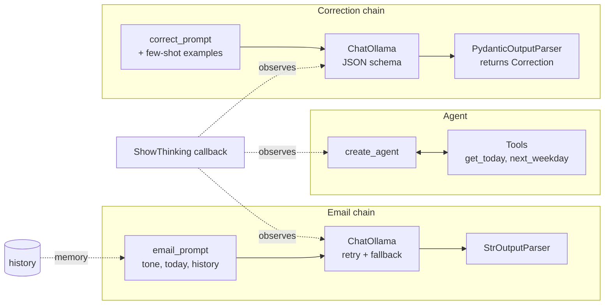

# LangChain Writing Assistant

**A private, offline AI writing assistant built with LangChain and Ollama: prompt templates, chains, structured output, conversation memory, tool-using agents and more, all running on a local model.**

[](https://github.com/rizwannazir333/langchain-writing-assistant/actions/workflows/ci.yml)


-6E40C9)


> **Series: Building the same AI app three ways**
> [Part 1: Plain Ollama](https://github.com/rizwannazir333/ollama-writing-assistant) · **Part 2: LangChain** (this repo) · [Part 3: LangGraph](https://github.com/rizwannazir333/langgraph-writing-assistant)

---

## Overview

In [Part 1](https://github.com/rizwannazir333/ollama-writing-assistant) I built an email writer and grammar
checker with nothing but the `ollama` library. It worked, but every capability had to be written by
hand, and the app had no memory, no tools and only free-text output.

In this repository I rebuild the **same application with LangChain** to demonstrate how a framework
turns those missing pieces into small, composable building blocks. The result is a single,
readable file that shows **ten core LangChain features** in a real, working context:

- **Draft emails** in any tone, then **revise them conversationally** (*"make it shorter"*).
- **Correct English** and receive the result as a **typed Python object**, not loose text.
- **Correct many sentences** in one batch call.
- Run an **agent** that decides on its own to call Python tools, e.g. to turn *"next Friday"* into a real date.

Everything runs locally on a 4-bit quantized model. **No API key, no cloud, no data leaves your machine.**

---

## LangChain Features Demonstrated

Each feature is marked with a `FEATURE` comment in [`langchain_writing_assistant.py`](langchain_writing_assistant.py).

| # | Feature | LangChain API | Role in this project |
|---|---|---|---|
| 1 | Chat model | `ChatOllama` | Local model with optional reasoning (`reasoning=`) |
| 2 | Prompt templates | `ChatPromptTemplate` | Reusable prompts with `{tone}`, `{today}`, `{request}` |
| 3 | Few-shot prompting | `FewShotChatMessagePromptTemplate` | Worked corrections that guide the model |
| 4 | Chains (LCEL) | `prompt \| model \| parser` | Composable pipelines for each task |
| 5 | Structured output | Pydantic + `PydanticOutputParser` | Corrections returned as typed objects |
| 6 | Memory | `MessagesPlaceholder` + message history | Conversational email revision |
| 7 | Batch | `.batch()` | Correct many lines in one call |
| 8 | Resilience | `.with_retry()` + `.with_fallbacks()` | Retry, then fall back to a backup model |
| 9 | Callbacks | `BaseCallbackHandler` | Stream reasoning and tool activity live |
| 10 | Tools & agents | `@tool` + `create_agent` | The model calls Python functions when it needs facts |

---

## Architecture



---

## Getting Started

### Prerequisites

- Python **3.10+**
- [Ollama](https://ollama.com/download) installed and running
- **8 GB RAM** minimum (16 GB recommended); **no GPU required**

### Installation

```bash
# 1. Download the model (one time, ~3.3 GB)
ollama pull qwen3.5:4b

# 2. Clone the repository
git clone https://github.com/rizwannazir333/langchain-writing-assistant.git
cd langchain-writing-assistant

# 3. Create a virtual environment and install dependencies
python -m venv .venv
# Windows
.venv\Scripts\python -m pip install -r requirements.txt
# macOS / Linux
.venv/bin/python -m pip install -r requirements.txt
```

> The script detects a `.venv` folder next to it and re-launches itself with that interpreter, so
> `python langchain_writing_assistant.py` works without activating the environment.

---

## Usage

### Interactive menu

```bash
python langchain_writing_assistant.py
```

```
[langchain | model: qwen3.5:4b | thinking: off]

1) Draft email          2) Revise last email
3) Correct English      4) Correct many lines
5) Email agent (finds real dates)      q) Quit
```

### Example: structured correction

```
> 3
Text to correct:
> they was going to the shop and buyed some bread

===== RESULT =====
Corrected: They were going to the shop and bought some bread.
Changes:
- they -> They (capitalization at start of sentence)
- was -> were (subject-verb agreement (plural subject))
- buyed -> bought (irregular past tense)
(29s)
```

### Example: agent with tools

```
> 5
What should the email say?
> ask my manager for next Friday off for a family event
[tool] next_weekday {'day': 'friday'}
[tool result] Friday 20 November 2026

===== RESULT =====
Subject: Request for Leave - Family Event

Dear [Manager],

I would like to request time off next Friday, November 20th, for a family event. ...
```

### One-line commands

```bash
python langchain_writing_assistant.py email "ask my manager for Friday off"
python langchain_writing_assistant.py --tone friendly email "invite the team to lunch on Thursday"
python langchain_writing_assistant.py correct "me and him is going to meeting tomorow"
python langchain_writing_assistant.py agent "ask my manager for next Friday off"
python langchain_writing_assistant.py --think correct "..."      # show reasoning
```

### Options

| Option | Description |
|---|---|
| `email` / `correct` / `agent` `TEXT` | Run one task and exit |
| `--tone TONE` | Email tone, e.g. `friendly`, `formal`, `apologetic` (default `professional`) |
| `--think` | Stream the model's reasoning live (more accurate, much slower on CPU) |
| `-m MODEL` | Use a specific Ollama model |

Model selection: first installed of `qwen3.5:4b` → `llama3.2:3b` → `qwen2.5:3b` → `qwen3.5:latest`.
Fallback model: `qwen2.5:3b`.

---

## Code Walkthrough

### Chains compose the application

```python
email_chain   = email_prompt | make_model(model, think) | StrOutputParser()
correct_chain = (correct_prompt
                 | make_model(model, think, Correction.model_json_schema())
                 | PydanticOutputParser(pydantic_object=Correction))
```

Each chain reads left to right: **fill the prompt → call the model → parse the result.**

### Structured output with Pydantic

```python
class Change(BaseModel):
    old: str
    new: str
    reason: str

class Correction(BaseModel):
    corrected: str
    changes: list[Change]
```

The JSON schema is passed to Ollama's `format` option, so the model is constrained to this shape,
and the parser returns a validated `Correction` object.

### Conversation memory

```python
history = []

def draft_email(chains, request, tone="professional"):
    answer = chains["email"].invoke({"request": request, "tone": tone,
                                     "history": history, ...}, CONFIG)
    history.extend([HumanMessage(request), AIMessage(answer)])
    return answer
```

The prompt's `MessagesPlaceholder("history")` injects earlier turns, so *"make it shorter"* revises the
previous email.

### Resilience: retry and fallback

```python
main.with_retry(stop_after_attempt=2).with_fallbacks([backup])
```

### Tools and an agent

```python
@tool
def next_weekday(day: str) -> str:
    """Return the date of the next given weekday, e.g. 'friday'."""

agent = create_agent(model, tools=[get_today, next_weekday], system_prompt=...)
```

The docstring is part of the tool's interface: the model reads it to decide when to call the tool.

### Callbacks for live visibility

```python
class ShowThinking(BaseCallbackHandler):
    def on_llm_new_token(self, token, chunk=None, **kwargs): ...   # stream reasoning
    def on_tool_start(self, serialized, input_str, **kwargs): ...  # log tool calls
```

---

## Performance

Measured on an **Intel Core i7-1165G7, 16 GB RAM, no GPU**, Windows 11, model `qwen3.5:4b`, thinking off:

| Task | Time |
|---|---|
| Correct one sentence (structured output) | **~25–30 s** |
| Draft / revise an email | **~20–30 s** |
| Agent email with one tool call | **~35–45 s** |
| With `--think` | several minutes per answer |

Speed comes from a quantized 4B model, a 2048-token context, capped output, and keeping the model
loaded in memory (`keep_alive="30m"`), pre-loaded at start-up.

---

## Design Decisions

- **One chain per task** keeps responsibilities clear and makes each pipeline reusable.
- **Structured output over text parsing:** constraining the model with a JSON schema is far more
  reliable than regex on free text, especially with small models.
- **Explicit message history** (a plain list plus `MessagesPlaceholder`) is used for memory because it
  is transparent and easy for learners to inspect. LangGraph's built-in persistence (Part 3) is the
  recommended approach for larger applications.
- **Thinking is opt-in:** on CPU it costs minutes; `--think` exposes it when accuracy matters more than speed.

---

## Limitations

- Small models may still add unrequested sentences to emails, or produce *"I and he"* instead of
  *"He and I"*. **Review AI-generated text before use.**
- The agent decides for itself whether to call a tool; occasionally it answers without one.
- Pipelines are linear: there is no self-review loop or human approval step. (Part 3 adds both.)

---

## Extend It

1. Add a third few-shot example and measure its effect on accuracy.
2. Add a `tone` field to the `Correction` model that describes the text's tone.
3. Create a `count_words` tool and instruct the agent to keep emails under 80 words.
4. Point `BACKUP_MODEL` at a model you don't have, then stop Ollama mid-request to observe the fallback.

---

## Troubleshooting

| Problem | Solution |
|---|---|
| `model "qwen3.5:4b" not found` | Run `ollama pull qwen3.5:4b` |
| `Connection refused` | Start the Ollama app, or run `ollama serve` |
| `ModuleNotFoundError: No module named 'langchain'` | Complete the installation step |
| `Sorry, something went wrong: ...` | The model returned invalid JSON; retry the request |
| Very slow responses | Avoid `--think`, run one model at a time (`ollama ps`) |

---

## Project Structure

```
langchain-writing-assistant/
├── langchain_writing_assistant.py  # the application
├── requirements.txt            # pinned dependencies
├── .gitignore                  # keeps .venv and caches out of Git
├── LICENSE                     # MIT License
└── README.md                   # this document
```

---

## Continue the Series

| Part | Repository | What it adds |
|---|---|---|
| 1 | [ollama-writing-assistant](https://github.com/rizwannazir333/ollama-writing-assistant) | Direct model access, prompting, streaming |
| **2** | **langchain-writing-assistant** (you are here) | Prompt templates, chains, structured output, memory, tools, agents |
| 3 | [langgraph-writing-assistant](https://github.com/rizwannazir333/langgraph-writing-assistant) | Graph workflows, self-review loops, human approval, parallelism, caching |

---

## License

Released under the [MIT License](LICENSE). You are free to use, modify and share this
project, including in your own courses and classrooms, as long as the copyright notice is kept.

---

## Author

Created and maintained by **[@rizwannazir333](https://github.com/rizwannazir333)**.

If this project helped you learn, please consider giving it a ⭐. Questions, suggestions and
improvements are welcome through [Issues](https://github.com/rizwannazir333/langchain-writing-assistant/issues).
